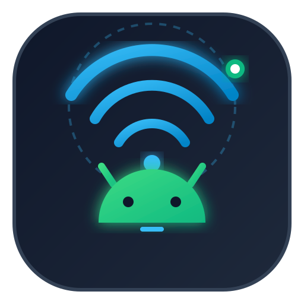
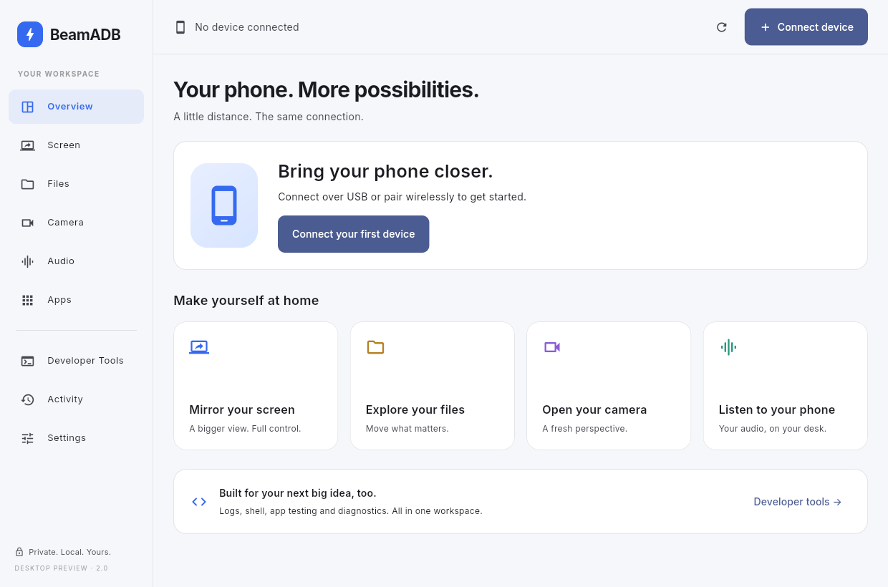

<p align="center">
  
</p>

<h1 align="center">BeamADB</h1>

<p align="center">
  <strong>Your Android phone. A bigger workspace.</strong><br>
  A standalone desktop companion for everyday phone access and professional Android development.
</p>

<p align="center">
  <a href="#platform-status"></a>
  <a href="#platform-status"></a>
  <a href="desktop/pubspec.yaml"></a>
  <a href="LICENSE"></a>
</p>

<p align="center">
  <a href="#get-started">Get started</a> ·
  <a href="#your-phone-within-reach">Features</a> ·
  <a href="#a-workspace-for-engineers-too">Developer tools</a> ·
  <a href="docs/DESKTOP_STATUS.md">Roadmap & status</a>
</p>

<p align="center">
  
  <br><sub>Linux desktop preview · Light appearance · No device connected</sub>
</p>

## Your phone, within reach

BeamADB brings phone access into a native Flutter desktop window. Start with the things you use most—your screen, files, camera and audio—then open the engineering workspace when you need more control.

| Workspace | What you can do |
| --- | --- |
| **Screen** | Mirror and control your phone inside the app, capture screenshots, record, use fullscreen, or open a separate window. |
| **Files** | Browse storage, transfer files and folders, drag and drop uploads, preview images and text, rename, copy, move and delete. |
| **Camera** | Preview the phone camera inside the app, choose a facing direction, capture frames and record. |
| **Audio** | Start phone-playback or microphone monitoring explicitly, mute playback and record supported streams. |
| **Apps** | Install APKs and split APK sets, launch or stop apps, inspect packages, export APK files and manage user apps. |
| **Connections** | Use USB, QR pairing, a six-digit code, direct wireless connection or USB-to-wireless migration. |

Light, dark and system themes, keyboard focus, reduced-motion preferences and persistent error details are included. The desktop app runs locally, requires no account, and does not start the legacy HTTP control server.

> **Preview status:** These capabilities are implemented, but real-phone validation is still pending. Native video, audio, recording and control transport have been tested with synthetic streams. Android version, device hardware and app restrictions affect what is available. See the [verification details and remaining work](docs/DESKTOP_STATUS.md).

## A workspace for engineers, too

Developer Tools stays accessible without filling everyday screens with technical controls.

- **Live logs:** bounded Logcat capture, severity and text filters, pause display, and export.
- **Shell:** cancellable commands, command history, output and failure details.
- **Diagnostics:** device properties, battery, memory, storage, bug reports and Perfetto trace capture.
- **Networking:** inspect and manage ADB forward/reverse port mappings.
- **App testing:** deep links, runtime permission actions, memory/rendering diagnostics and instrumentation tests.
- **Workflows:** save, review and run sequential Android shell commands, stopping on the first failure.

Operations include timeouts and cancellation where supported. Failures remain visible with details in Activity. The current shell is a command runner; saved workflows are reviewed shell sequences, rather than a full automation framework.

## Platform status

| Target | Current status |
| --- | --- |
| **Linux x86-64** | Release bundle and `.deb` preview built on Ubuntu 26.04; native startup and automated tests passed. |
| **Windows** | Flutter runner and platform dependencies included; build and runtime validation pending. |
| **Other Linux distributions / architectures** | Not yet validated. Build against your target distribution; the bundled Linux ADB tools currently require x86-64. |

Wireless debugging pairing requires **Android 11+**. Camera capture requires **Android 12+**. USB debugging must be enabled and authorized for USB access. Audio capture and protected content depend on Android and individual apps. Camera preview does not create a system virtual webcam.

Separate-window mode currently restarts the selected stream in another native app window. Seamless detach/reattach is on the [roadmap](docs/DESKTOP_STATUS.md#remaining-work-from-the-broader-product-plan).

## Get started

### Build the Linux desktop app

You need [Flutter with Linux desktop tooling](https://docs.flutter.dev/platform-integration/desktop), GTK 3, and libmpv development libraries. The current preview was built with Flutter 3.47.7 on Ubuntu 26.04 x86-64; the Dart SDK minimum is recorded in [`pubspec.yaml`](desktop/pubspec.yaml).

```bash
git clone https://github.com/abdullohanvarov/beamadb.git
cd beamadb

# Optional Ubuntu dependency cache if libmpv-dev is not installed.
# Downloads/extracts media packages locally; does not install system packages.
./tools/prepare-media-linux.sh

# Analyze, run unit/widget tests and build the release bundle.
./tools/build-desktop-linux.sh

# Open the standalone app.
./launch.sh
```

If Flutter is not on your PATH:

```bash
FLUTTER_BIN=/path/to/flutter ./tools/build-desktop-linux.sh
```

The complete application is written to:

```text
desktop/build/linux/x64/release/bundle/
```

Keep the bundle together, including `lib/`, `data/`, `bin/` and `licenses/`. Run its `beamadb` launcher when moving the bundle elsewhere.

### Build a Debian installer

After building the release bundle:

```bash
./tools/package-desktop-linux.sh
sudo apt install './dist/beamadb-desktop_2.0.0~preview1_amd64.deb'
```

Launch **BeamADB** from your applications menu or run `beamadb-desktop`. The package targets the distribution used to build it and declares its runtime dependencies. Installers are generated locally; they are not included in Git.

### Connect your phone

1. Enable **Developer options** on the phone.
2. For USB, enable **USB debugging**, connect a data cable, unlock the phone and approve the computer.
3. For wireless, connect both devices to the same local network, enable **Wireless debugging**, then choose **Connect device** in BeamADB.
4. Select **QR code** or **Pairing code** and follow the phone's pairing instructions.
5. Choose **Screen**, **Files**, **Camera** or **Audio** in the sidebar.

For manual wireless connection, use the connection port on the main Wireless debugging screen. It differs from the temporary pairing port.

## Development & verification

```bash
cd desktop
flutter pub get
flutter analyze
flutter test test
```

The current validation record contains **10 unit/widget tests and 4 native integration tests**, plus a release-launch and package-content check. Native integration tests exercise navigation, texture decoding, a simulated scrcpy transport, recording and PCM audio. They need libmpv and a generated video fixture; instructions are in the [desktop development guide](desktop/README.md#verification).

Real-device testing, Windows testing and broader Linux/GPU coverage remain necessary. Report issues with your OS, Android version, connection method, reproduction steps and relevant Activity output. Review diagnostic output before sharing it.

### Project layout

```text
desktop/     Flutter app, Linux/Windows runners and tests
docs/        Architecture, verification status, roadmap and preview
tools/      Build, dependency preparation and packaging scripts
bin/scrcpy/  Bundled platform tools and capture servers
beamadb      Python CLI and explicit legacy web launcher
server.py    Legacy local web server
static/      Legacy web interface and project icon
```

## CLI & legacy web interface

The Python CLI remains available alongside the desktop app:

```bash
./beamadb                 # Launch the built native desktop app
./beamadb devices         # List connected phones
./beamadb pair            # Pair using a terminal QR code
./beamadb help            # See the full CLI command list
./beamadb web             # Explicitly launch the legacy browser interface
```

The existing GitHub release workflow and frozen Python Windows installers still package the legacy CLI/web version. They do not build the Flutter desktop app.

The legacy web server now binds to localhost. The desktop runtime operates independently of it. Earlier CLI/web features and packaging instructions are preserved in the [legacy guide](docs/LEGACY_WEB.md).

## Documentation

- [Desktop build and test guide](desktop/README.md)
- [Architecture and media integration](docs/DESKTOP_ARCHITECTURE.md)
- [Implementation status and roadmap](docs/DESKTOP_STATUS.md)
- [Bundled tool checksums](docs/bundled-tools.json)
- [Legacy CLI and web guide](docs/LEGACY_WEB.md)

## License & credits

BeamADB application source is available under the [MIT License](LICENSE). Bundled tools, fonts and native media libraries retain their own licenses; see their notices and the [dependency documentation](docs/DESKTOP_ARCHITECTURE.md#runtime-dependencies). The bundled Inter font includes its [Open Font License](desktop/assets/fonts/OFL.txt).

Built with Flutter, Android Debug Bridge, scrcpy and media_kit.

Created by [Abdulloh Anvarov](https://github.com/abdullohanvarov).
